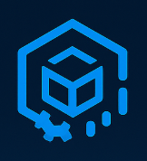

# Karip Traker



AION 2 karakter takip sitesi ve masaüstü uygulaması.

AION 2 (Global EU, Siel) karakterleri için iki kişilik takip sitesi. GitHub Pages üzerinde çalışır, sunucu tarafı yoktur.

- **Giriş:** site kullanıcı adı ve şifreyle açılır. Giriş yapan iki hesap da tam yetkilidir. Arkadaşının GitHub hesabına gerek yoktur.
- **Kartlar:** sınıf, seviye, item level, combat power ve Odyle Energy paneli. Karta tıklayınca Gear / Arcana / Skill penceresi açılır.
- **Karşılaştırma:** item level, combat power, seviye ya da enerjiye göre sıralama ve slot slot gear karşılaştırması
- **Enerji:** elle girilir, site "şu an ~X" ve "full'e Y saat" değerlerini canlı hesaplar. Full olan kart kırmızı, full'e yakın olan turuncu görünür.
- **Gear verisi:** GitHub Actions günde 3 kez resmi siteden çeker. İstenirse sitedeki "Şimdi güncelle" butonuyla elle de tetiklenir.

```
index.html                     Sayfa (giriş ekranı + uygulama)
assets/css/style.css           Koyu tema
assets/js/app.js               Yükleme, giriş, kaydetme, hesap kurulumu, workflow tetikleme
assets/js/auth.js              Şifreli token, giriş ve oturum
assets/js/render.js            Kartlar, pencereler, tablolar
assets/js/energy.js            Enerji hesabı
assets/js/github.js            GitHub API
assets/js/merge.js             Kaydetme çakışmasında birleştirme
data/data.json                 Tüm veri + şifreli hesaplar (auth)
scripts/fetch-characters.mjs   Gear çeken script (Node 20+, bağımlılık yok)
.github/workflows/update.yml   Zamanlanmış gear güncellemesi
.github/workflows/inbox.yml    Ekran izleyici kayıtlarını data.json'a uygular
scripts/apply-inbox.mjs        data/inbox/ işlemlerini uygulayan script
tools/izleyici/                Ekran izleyici (Baslat.bat + izleyici.ps1)
assets/js/ops.js               Anında kaydedilen işlemler (liste, zindan, enerji)
assets/js/dungeons.js          Zindan garanti sayaçları
assets/js/todos.js             Yapılacaklar listesi
```

---

## Güvenlik nasıl çalışır?

Site statik olduğu için şifreler bir sunucuda kontrol edilemez. Bunun yerine:

1. Site sahibi bu repoya yazabilen **tek bir GitHub token'ı** oluşturur.
2. **Hesap kurulumu** ekranında token, her hesabın şifresiyle tarayıcıda **ayrı ayrı şifrelenir** (PBKDF2-SHA256 600.000 tur + AES-GCM 256).
3. `data.json` dosyasına sadece şifreli haller yazılır. Gerçek token ve şifreler hiçbir yerde saklanmaz.
4. Giriş yapan kişinin şifresi doğruysa token tarayıcıda çözülür ve kayıtlar bu token'la yapılır. Yanlışsa çözülemez, kimse yazamaz.

Bilmen gerekenler:

- **Şifreler güçlü olmalı:** en az 12 karakter ve rastgele. Şifreli kayıt herkese açık durduğu için zayıf bir şifre deneme yanılmayla kırılabilir. Güçlü bir şifreyle bu pratikte mümkün değil.
- **Giriş ekranı görüntülemeyi gizler ama veri teknik olarak okunabilir.** Repo public olduğu için `data.json` doğrudan açılabilir. İçindeki oyun verisi resmi sitede zaten herkese açık. Enerji değerleri de görülebilir ama **değiştirilemez**.
- **Kayıt geçmişi:** commit'ler GitHub'da senin hesabınla görünür. Kimin kaydettiği commit mesajında site kullanıcı adıyla yazar, ör. `Enerji: Kyrakia 0+1710 (ali)`.
- **"Beni bu cihazda hatırla":** işaretlenirse çözülmüş token o tarayıcıda kalır. İşaretlenmezse sekme kapanınca silinir. Ortak bilgisayarda işaretleme ve işin bitince ⚙ → **Çıkış yap**.

---

## 1. Repoyu oluşturma

1. GitHub'da sağ üstteki **+** → **New repository**:
   - Ad: örn. `aion2-takip`
   - **Public** (ücretsiz planda Pages için gerekli)
   - README ekleme (bu klasörde zaten var).
2. Dosyaları yükle. Bu klasörde terminal açıp:

   ```bash
   git init -b main
   git add .
   git commit -m "İlk sürüm"
   git remote add origin https://github.com/KULLANICI_ADIN/aion2-takip.git
   git push -u origin main
   ```

   Git kullanmak istemiyorsan GitHub'da **Add file → Upload files** ile tüm klasörü sürükleyip bırakabilirsin. `.github` klasörünün de yüklendiğinden emin ol.

## 2. GitHub Pages'i açma

1. Repo → **Settings → Pages**.
2. **Source:** "Deploy from a branch". **Branch:** `main`, klasör: `/ (root)` → **Save**.
3. 1-2 dakika sonra adres görünür: `https://KULLANICI_ADIN.github.io/aion2-takip/`

## 3. Token oluşturma (sadece site sahibi)

1. GitHub → sağ üst profil → **Settings → Developer settings → Personal access tokens → Fine-grained tokens → Generate new token**.
2. Ayarlar:
   - **Token name:** `aion2-takip`
   - **Expiration:** en fazla 1 yıl. Süresi dolunca 4. adımı yeni token'la tekrarlarsın.
   - **Repository access:** *Only select repositories* → `aion2-takip`
   - **Permissions → Repository permissions:**
     - **Contents:** Read and write
     - **Actions:** Read and write
     - (Metadata: Read-only otomatik eklenir)
3. **Generate token** → `github_pat_…` ile başlayan değeri kopyala. Bu değer bir daha gösterilmez, ama saklamana da gerek yok. 4. adımda şifrelenip repoya yazılacak.

## 4. Hesapları kurma

1. Pages adresini aç. Henüz hesap olmadığı için site salt okunur açılır.
2. ⚙ → **Hesap kurulumu**:
   - Token'ı yapıştır. Repo sahibi ve adı Pages adresinden otomatik dolar.
   - Hesap satırlarına kullanıcı adı ve şifre yaz: biri senin, biri arkadaşının. Büyük/küçük harf fark etmez.
   - **Şifrele ve kaydet** → "✔ 2 hesap kaydedildi" yazısını görmelisin.
3. Artık site giriş ekranıyla açılır.
4. **Arkadaşına sadece site linkini, kullanıcı adını ve şifresini ver.** GitHub hesabı gerekmez.

**Hesap eklemek, şifre değiştirmek ya da token yenilemek:** girişten sonra ⚙ → **Hesap kurulumu** ya da giriş ekranındaki "Hesap kurulumu" bağlantısı. Kaydedince tüm hesaplar bu listeyle değiştirilir. Bu yüzden tüm hesapların şifrelerini yeniden girmen gerekir. Token gerektiği için bunu sadece site sahibi yapabilir.

## 5. Kullanım

- **Düzen:** soldaki menüde (telefonda altta) **Genel bakış** (karakterlerin enerjisi, yaklaşan bosslar, açık yapılacaklar), **Karakterler**, **Bosslar**, **Yapılacaklar**, **Karşılaştırma** ve **Uygulama** (ekran izleyicinin paneli) var.
- **Enerji girme:** Odyle Energy iki ayrı satırda tutulur:
  - **Zamanla:** kendiliğinden dolan kısım (max 840). "Full'e kalan süre" ve kırmızı/turuncu vurgular sadece bu kısma göre hesaplanır.
  - **Ek (+):** sizin eklediğiniz kısım. Zamanla değişmez, max'a sayılmaz.

  Kutuya oyundaki değeri yaz ve Enter'a bas, ya da −/+ butonlarını kullan. Harcadığında oyunda hangi kısım düştüyse o satırdan düş. Altta **Toplam** görünür. Değişen kartta "● kaydedilmedi" yazar.
- **Kaydet (N):** bekleyen tüm değişiklikleri tek commit olarak `data.json`'a yazar. O sırada arkadaşın ya da Actions dosyayı değiştirmişse site güncel dosyayı çeker, sadece senin değiştirdiğin enerji değerlerini üstüne uygular ve tekrar dener. Aynı karakteri arkadaşın senden *sonra* düzenlediyse onun değeri kalır.
- Kaydetmeden sayfayı kapatırsan değişiklikler o tarayıcıda saklı kalır. Tarayıcı ayrıca uyarı da verir.
- **Gear güncelle:** gear çekme işini (workflow) tetikler ve durumunu gösterir (Sırada → Çalışıyor → bitti). Bitince veriyi kendiliğinden yeniden yükler.
- **Karakter penceresi:** kartın üst kısmına ya da **Detay ›** butonuna tıkla. Üç sekme var:
  - **Gear:** silah ve zırh, rün, aksesuar, kanat ve pet
  - **Arcana:** 5 arcana, statları ve ek skilleri
  - **Skill:** aktif, pasif ve DP skilleri. Takılı olanlar yeşil kenarlı, öğrenilmemişler soluk.

  Bağlantı: `…/#char/kyrakia/skills`
- **Eşya detayı:** penceredeki ya da karşılaştırma tablosundaki bir parçaya tıkla (klavyede Enter). Ana statlar, ek statlar ve skiller, set bonusu, büyü taşları ve tanrı taşı görünür. ‹ › butonları ya da ok tuşlarıyla parçalar arasında gezebilirsin. Bağlantı: `…/#item/kyrakia/0`.
- **Ayarlar dosyası:** `data/data.json` içindeki `config` bölümü:
  ```json
  "energy": { "name": "Odyle Energy", "max": 840, "regenAmount": 15, "regenMinutes": 180, "tickAnchorUtc": null, "steps": [10, 40], "bonusSteps": [10, 40] },
  "nearFullHours": 3
  ```
  - `max`, `regenAmount`, `regenMinutes`: doğal enerji sınırı ve dolum hızı. Topluluk kaynaklarına göre dolum 3 saatte 15, sınır aboneliksiz 560, abonelikle 840 (ek enerji dahil toplam en fazla 2000).
  - `tickAnchorUtc`: oyunda enerji sabit saatlerde geliyorsa bir tik anı yaz, örn. `"2026-01-01T00:00:00Z"`. Böylece "sonraki +15" süresi tam doğru olur. Boş bırakılırsa tikler değerin girildiği andan itibaren sayılır.
  - `steps` / `bonusSteps`: "Zamanla" ve "Ek (+)" satırlarındaki +/− butonlarının miktarları.
  - `nearFullHours`: kaç saat kala turuncu vurgunun başlayacağı.
- **Karakter ayarları** (`characters` içinde, karakter başına):
  - `"owner": "Ali"` → kartta isim etiketi görünür.
  - `"energyMax": 560` → aboneliği olmayan karakter için doğal enerji sınırı.
  - `"fetch": false` → bu karakter otomatik çekilmez.
- Enerji resmi sitede herkese açık değil. Bu yüzden otomatik çekilemez, oyundan bakıp elle girilir.

## 6. Gear otomatik güncelleme ve yeni karakter ekleme

`scripts/fetch-characters.mjs` resmi karakter sayfasının kullandığı uç noktalarla çalışır:

| Amaç | Adres |
|---|---|
| Sunucu listesi | `aion2.plaync.com/api/gameinfo/servers?region=eu` |
| Karakter arama | `api-search.plaync.com/aion2global/search/v2/character?keyword=…&serverId=1301&region=eu` |
| Profil, item level, combat power | `aion2.plaync.com/api/character/info?characterId=…&serverId=…` |
| Ekipman, skill, pet ve kanat | `aion2.plaync.com/api/character/equipment?characterId=…&serverId=…` |
| Parça detayı (stat, skill, set, taşlar) | `aion2.plaync.com/api/character/equipment/item?id=…&enchantLevel=…` |

- Karakter **adıyla, ayarlardaki sunucuda (Siel = 1301)** aranır. Bulunan kimlik `ref` alanına kaydedilir, sonraki çalıştırmalarda arama yapılmaz.
- Parça detayları her çalıştırmada yeniden çekilir, çünkü ek statlar ve taşlar aynı eşyada da değişebilir. İstekler dörder dörder paralel atılır, bir karakter yaklaşık 7 saniye sürer.
- Script `energy` ve `auth` alanlarına dokunmaz. Değişiklik yoksa commit atılmaz.
- Başarıyla çekilen karakterin "örnek veri" etiketi kendiliğinden kalkar.

**Yeni karakter eklemek ya da beklemedekini açmak:** `data/data.json` içinde karakterin `name` alanı oyundakiyle birebir aynı olmalı. `"fetch": false` satırını sil. Ya da kendi bilgisayarında hemen dene (Node 20+):

```bash
node scripts/fetch-characters.mjs --only Kyrakia            # çek ve data.json dosyasına yaz
node scripts/fetch-characters.mjs --dry-run --only Kyrakia  # sadece göster, dosyaya yazma
node scripts/fetch-characters.mjs                           # "fetch": false olmayan herkesi güncelle
```

## 6b. Ekran izleyici (otomatik enerji ve zindan sayacı)

`tools/izleyici/` klasöründeki küçük program, oyundaki enerji harcayan ödül kutusu pencerelerini (**Odyle Energy Cube** ve **Transcendence**) ekrandan okur:

- **Pencere açılınca:** sağ üstteki enerjiyi (ör. `0(+845)/840`) ve zindanın garanti sayacını (ör. `20/28`) okuyup sitedekiyle **eşitler**.
- **Pencere kapanınca:** Open'a basıldığını varsayar. Enerjiden maliyeti düşer (önce zamanla dolan, sonra ek kısım) ve garanti sayacını kutu sayısı kadar ilerletir.
- **Transcendence kutuları** (ör. Shattered Arkanis): aynı pencere ama garanti sayacı yok. Açılınca sadece enerji eşitlenir, kapanınca sadece maliyet enerjiden düşülür; zindan sayaçlarına dokunulmaz.
- **Cancel'a basıldıysa:** bir sonraki açılışta ekrandan okunan değerlerle kendiliğinden düzelir. Yanlış bir kayıt olursa uygulama panelindeki **Son kaydı geri al** butonu da var.
- Oyuna, oyun dosyalarına ve ağ trafiğine **dokunmaz**, klavye ve fare dinlemez. Sadece ekran görüntüsü alır ve Windows'un yerleşik yazı tanımasını kullanır.
- **Performans:** normalde sadece "Open" butonunun olduğu küçük bir alana bakar, bu da neredeyse sıfır yük demek. Yazı tanıma sadece pencere açıkken çalışır.

**Kurulum (ikiniz de, kurulum gerektirmez):**

1. GitHub'da repo sayfası → **Code → Download ZIP**. ZIP'i aç ve `tools/izleyici` klasörünü istediğin bir yere kopyala (`Baslat.bat`, `izleyici.ps1` ve `ag.cs` birlikte durmalı).
2. `Baslat.bat` dosyasına çift tıkla. Windows "bilinmeyen yayıncı" uyarısı verirse: dosyaya sağ tık → **Özellikler** → alttaki **Engellemeyi kaldır** → Tamam.
3. **Uygulama penceresi** açılır: sitenin kendisi, sekmesiz kendi penceresinde. Saat yanında da **Karip Traker** simgesi belirir.
4. Pencerede **site kullanıcı adın ve şifrenle** bir kez giriş yap. Ekran izleyici de aynı hesapla bağlanır; sonraki açılışlarda giriş sormaz.
5. **Uygulama** bölümünden o an oynadığın **aktif karakteri** seç. Karakter değiştirince burayı da değiştir.
6. Oyunu **çerçevesiz pencere** modunda, **ana ekranda** oyna. Pencereyi kapatsan da izleyici arka planda çalışmaya devam eder; tekrar açmak için simgeye çift tıkla. Tamamen kapatmak için simge → sağ tık → **Çıkış**.

**Uygulama bölümü:** izleyicinin durumu (İzliyor / Duraklatıldı), aktif karakter, son okunan kutu, kayıt listesi ve **Duraklat**, **Son kaydı geri al**, **Ekranı şimdi oku** butonları. Discord'da arkadaşının yayınını tam ekran izlerken **Duraklat**'a bas; aksi halde yayındaki kutular senin karakterine yazılabilir.

**Güvenlik:** uygulama yalnızca bu bilgisayarın içinden (`127.0.0.1:47321`) erişilebilir. Komutlar sadece uygulama penceresinden kabul edilir; başka bir site tarayıcı üzerinden izleyiciye komut gönderemez ya da oturumu okuyamaz. Oturum Windows'un kullanıcıya özel şifrelemesiyle (`%APPDATA%\aion2-izleyici\oturum.dat`) saklanır.

**İlk kullanımda kontrol:** ödül penceresi açıkken simge → sağ tık → **Ekranı şimdi oku** (ya da Uygulama bölümündeki buton). Kayıtlarda zindan, maliyet, kutu, garanti ve enerji değerleri doğru görünmeli. Yanlışsa kaydedilen ekran görüntüsünü bana gönder (konum kayıtta yazar: `%APPDATA%\aion2-izleyici`).

**Kayıtlar siteye nasıl gelir?** Program her olayı repodaki `data/inbox/` klasörüne küçük bir dosya olarak gönderir. **Izleyici kayıtlarını uygula** workflow'u (`.github/workflows/inbox.yml`) bunları sitenin kullandığı kurallarla (`assets/js/ops.js`) `data.json`'a uygular. Siteye yansıması yaklaşık yarım dakika sürer, canlı yenileme sayesinde F5 gerekmez.

### Ağ okuma (oyun trafiği)

Npcap kuruluysa (Questlog gibi sayaçlar kurduysa zaten vardır; yoksa [npcap.com](https://npcap.com)), izleyici **AION2.exe'nin kendi
bağlantılarına gelen trafiğin bir kopyasını** okur ([tools/izleyici/ag.cs](tools/izleyici/ag.cs)). Oyuna, dosyalarına ya da belleğine
dokunmaz, paket göndermez. Yönetici izni gerekmez (Npcap'in "sadece yöneticiler" ayarı kapalıysa; varsayılan budur).

- **Aktif karakter kendiliğinden seçilir:** oyundaki karakterin adı sitedekiyle eşleşince.
- **Odyle enerjisi** (doğal + ek) oyunun kendi değeriyle siteye yazılır. Bu sırada ekran okuyucu enerjiyi düşmez, sadece zindan sayacını işler (iki kez düşmesin).
- **Parti listesi:** savaş başlamadan Hasar bileşeni partideki oyuncuları gösterir: sınıf, ad, sunucu, seviye, GS ve CP, lider (♛); başlıkta parti ortalaması. Ayarlardan GS + CP / sadece CP / sadece GS seçilir; savaş başlayınca kendiliğinden hasar listesine geçer (Parti / Hasar düğmeleriyle elle de değişir).
- **Saha bossu ölünce** Bosslar sayacı kendiliğinden işaretlenir (48 saha bossu, NPC koduyla).
- **Hasar (DPS):** oyun içi menüdeki **Hasar** bileşeni. Üstten **Ben / Parti / Herkes** seçilir. Her oyuncu için sınıf, DPS, toplam hasar, pay, kritik oranı (ayarlardan en büyük vuruş ve alınan hasar da açılır); bir oyuncuya tıklayınca yetenek dökümü (hasar, pay, vuruş, kritik, en büyük vuruş), DoT payı ve alınan hasar. Çağrılan yaratıkların hasarı sahibine eklenir. Hedef saha bossu ya da büyük bir hedefse adı ve HP'si görünür; o ölünce savaş kapanır. Son 6 savaş ‹ › ile gezilir. Yetenek adları: [assets/data/skills.json](assets/data/skills.json).
- Uygulama bölümünde durumu görünür; oradan kapatılabilir. **Paket kaydı** düğmesi geliştirme içindir (trafiği `%APPDATA%\aion2-izleyici\paket-*.bin` dosyasına yazar, sohbet de dahil); işin bitince kapat.
- Protokol bilgisi topluluğun açık kaynak sayaçlarından (A2Tools DPS Meter, TK-open-public Aion2-Dps-Meter) öğrenildi; kod bu proje için yazıldı.
- Not: NCSOFT'un kuralları "izinsiz program" kullanımını yasaklar ve sayaçlar resmi olarak onaylı değildir. Bilinen bir yaptırım yok ama risk tamamen sıfır değildir.

### Oyun içi arayüz (overlay)

Uygulama açıkken oyunda **Alt+Shift+O** ile **oyun içi menü** açılır (ya da simge → **Oyun içi menü**, ya da sitede **Uygulama** bölümü).
Menüde **Enerji, Bosslar, Gear, Yapılacaklar, Zindanlar, Son kutu, Saat, Uygulama durumu** düğmeleri var. Bir düğmeye basınca o bilgi
kendi küçük penceresinde ekrana gelir; tekrar basınca kalkar.

- **Yerleştirme:** bileşeni üst kısmından tutup ekranın istediğin yerine sürükle, sağ alt köşesinden boyutlandır. Konum hatırlanır.
- **Oyun modu:** bileşenler yarı saydamdır ve tıklamalar içinden oyuna geçer, oyunu engellemez.
- **Kullanım modu:** oyunda imleci açıp (ör. Alt) bir bileşenin üstüne gelince o bileşen tam görünür ve tıklanabilir olur
  (⚙ ayarlar, ✕ kaldır, karakter seçimi…). İmleç ayrılınca oyun moduna döner. Pencereler odak almaz; klavye oyunda kalır.
- **Menüdeki ayarlar:** oyun modundaki görünürlük, yazı boyutu, imleçle etkinleştirme, düzenleme modu, hepsini gizle, konumları sıfırla.
  Her bileşenin kendi ⚙ ayarları da var (ör. enerjide hangi karakterler, kaç boss). Ayarlar kullanıcıya özeldir.
- **Kısayollar:** **Alt+Shift+O** menü · **Alt+Shift+H** hepsini gizle/göster · **Alt+Shift+T** düzenleme modu (bütün bileşenler kullanılabilir).
- Oyun **çerçevesiz pencere** modunda olmalı (özel tam ekranda hiçbir pencere oyunun üstünde görünemez).
- Bileşenler ayrı pencerelerdir: oyuna hiçbir şey eklenmez, oyunun belleği okunmaz.

Yeni bileşen eklemek için [assets/js/overlay.js](assets/js/overlay.js) içindeki `WIDGETS` listesine bir giriş, [overlay.html](overlay.html) içindeki başlık listesine adını eklemek yeterli; menüde kendiliğinden çıkar.

## 6c. Boss zamanlayıcıları ve bildirimler

**Bosslar** sekmesinde EU sunucusunun saha ve Abyss bossları listelenir:

- **Saha bossları** (Verteron = Elyos, Altgard = Asmodian, 48 boss): öldükten sonra sabit sürede (30 dk – 11 sa) yeniden doğar. Boss ölünce **Öldü**'ye bas; geç kaldıysan **Saat…** ile ölüm saatini (ör. `14:35`) ya da kaç dakika önce öldüğünü (ör. `25`) gir. Oyundaki saha bossu listesinde kalan süre yazıyorsa onu `+` ile gir (ör. `+2:15`). İşaret herkese yansır.
- **Abyss** (Watcher Kaira, Argo the Spirit King, Artifact Siege, Executors): sunucu saatine (CET/CEST) göre sabit programla çıkar, işaretlemeye gerek yok.
- **★** ile takip ettiğin bosslar için bildirim gelir: seçtiğin süre kadar önce (varsayılan 5 dk) ve doğduğu an. Takip listesi kişiye özeldir.
- Bildirim için **🔔 Bildirimleri aç**'a basıp izin ver. Site bir sekmede açık kalmalı (arka planda olabilir).
- Süreler topluluk kaynaklarından alındı (Kasım 2026, 4 Kasım yaması sonrası). Değişirse [assets/js/bosses.js](assets/js/bosses.js) içindeki listeden düzeltilir.

## 7. İlk çalıştırma kontrol listesi

1. Pages adresini aç. Kyrakia gerçek veriyle, diğerleri "örnek veri" etiketiyle salt okunur görünmeli.
2. ⚙ → **Hesap kurulumu** → token ve iki hesap → kaydet. Repoda "Hesaplar güncellendi (2 hesap)" commit'i görünmeli.
3. Giriş yap. Sağ üstte "Giriş: kullanıcıadın" yazmalı.
4. Bir karta enerji gir → **Kaydet** → repoda "Enerji: … (kullanıcıadın)" commit'i görünmeli.
5. **Şimdi güncelle** butonuna bas. Repo → **Actions** sekmesinde iş çalışmalı ve yeşil bitmeli.
6. Arkadaşın kendi kullanıcı adı ve şifresiyle giriş yapabilmeli.

## Lokal test

`index.html` dosyasına çift tıklayarak açarsan tarayıcı `data.json`'u okumaz (`file://` kısıtı). Klasörde basit bir sunucu başlat:

```bash
npx serve .            # ya da
python -m http.server 8000
```

Sonra `http://localhost:8000` adresini aç. Giriş ve şifreleme localhost'ta da çalışır.

## Sorun giderme

| Belirti | Çözüm |
|---|---|
| "Kullanıcı adı ya da şifre hatalı" | Kullanıcı adını ve şifreyi kontrol et. Hesap yeni kurulduysa Pages kopyası birkaç dakika eski olabilir, biraz bekleyip sayfayı yenile. |
| "Oturum geçersiz: GitHub token'ının süresi dolmuş…" | Token'ın süresi dolmuş ya da silinmiş. Site sahibi yeni token oluşturup **Hesap kurulumu**'nu tekrarlamalı. |
| Hesap kurulumunda "yazma yetkisi yok" | Token'da *Contents: Read and write* yok, ya da token başka bir repo için oluşturulmuş. |
| "Şimdi güncelle" 403/404 | Token'da *Actions: Read and write* yok, ya da `.github/workflows/update.yml` repoda değil. |
| "Tarayıcı şifrelemeyi desteklemiyor" | Site `https://` (GitHub Pages) ya da `localhost` üzerinden açılmalı. |
| Değişiklik birkaç dakika görünmüyor | Girişten önce veri Pages önbelleğinden gelir (≈10 dk). Giriş yapınca veri doğrudan GitHub API'den gelir. |
| Actions'ta "JSON yerine HTML döndü" | Resmi site GitHub sunucularından gelen isteği engelliyor olabilir. Bana haber ver, başka bir yol bakarız. |
| Zamanlanmış iş çalışmıyor | GitHub, 60 gün commit olmayan repolarda cron'u durdurur. Actions sekmesinden tekrar etkinleştir. |
